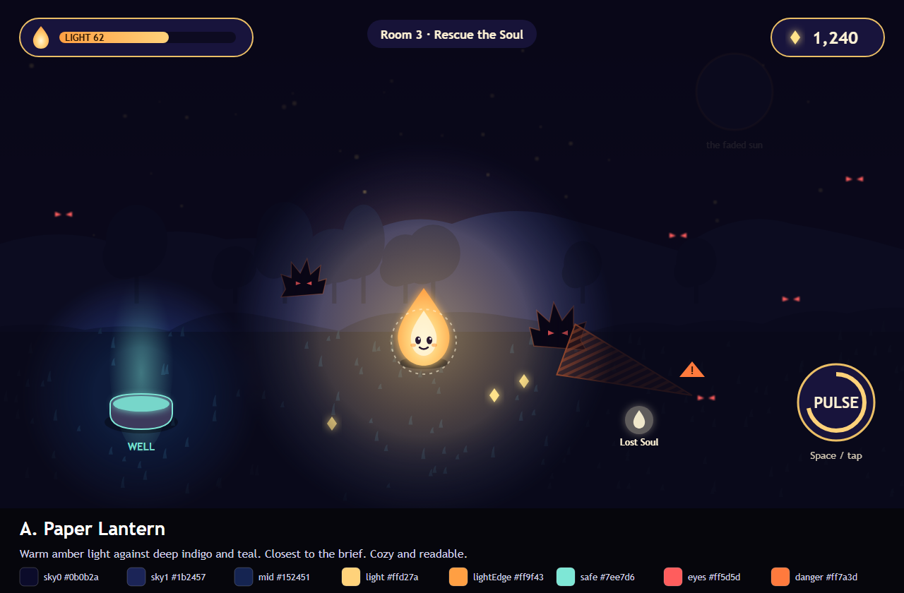

# Sunfetch

A single-player top-down action roguelite for the browser. You are Tindle, a small lantern spirit. Your light is your
health and your weapon. Bring the sun home.

Status: **Phase 0 done (concept locked).** Phase 1, the vertical slice, is next.

| Document | What it holds |
| -------- | ------------- |
| [docs/GDD.md](docs/GDD.md) | Game design: rules, content, meta, ads, tech plan |
| [docs/STORY.md](docs/STORY.md) | Story script, endings and character bios |
| [docs/DECISIONS.md](docs/DECISIONS.md) | The owner's decisions and the name checks |
| [docs/ASSETS.md](docs/ASSETS.md) | Third-party asset register and credits plan |
| [docs/phases/](docs/phases/) | One report per phase |

Tools:

- `node docs/mockups/make-mockups.mjs` regenerates the mockups.
- `node scripts/check-size.mjs <build-dir>` checks a build against the size limits.
- `node --test scripts/check-size.test.mjs` tests the size check.
