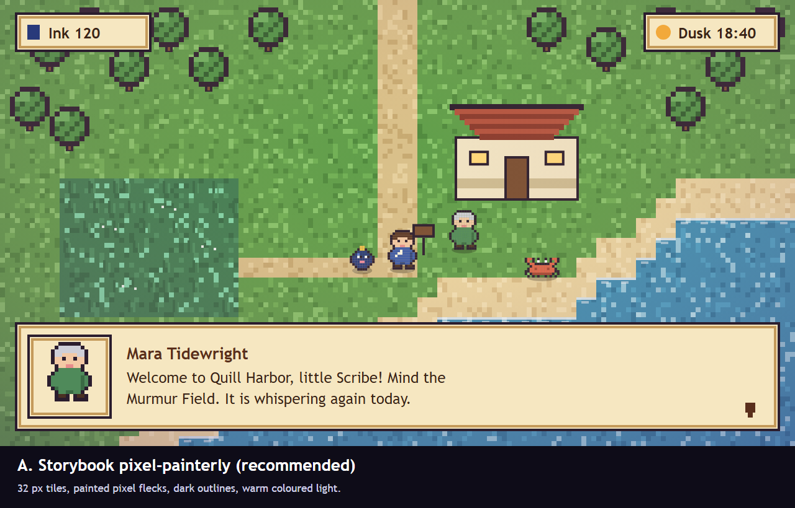

# Mythwake (working title)

A single-player creature-adventure RPG for the browser. You are a young Scribe in a world that is a living storybook.
Bind legends in creature form (Echoes), build a team for 3v3 Chorus battles, win the Keepers' Pages and decide how the
story ends.

Status: **Phase 0, concept lock.** No game code yet. Open questions: [docs/DECISIONS.md](docs/DECISIONS.md).

| Document | What it holds |
| -------- | ------------- |
| [docs/GDD.md](docs/GDD.md) | Game design |
| [docs/STORY.md](docs/STORY.md) | Story outline, cast, endings, side content |
| [docs/ECHOES.md](docs/ECHOES.md) | The 70 Echo families |
| [docs/MOTIFS.md](docs/MOTIFS.md) | The Motif (type) wheel |
| [docs/DECISIONS.md](docs/DECISIONS.md) | Owner decisions |
| [docs/ASSETS.md](docs/ASSETS.md) | Third-party asset register |
| [docs/phases/](docs/phases/) | One report per phase |

Mockups are generated with `node docs/mockups/make-mockups.mjs`.
