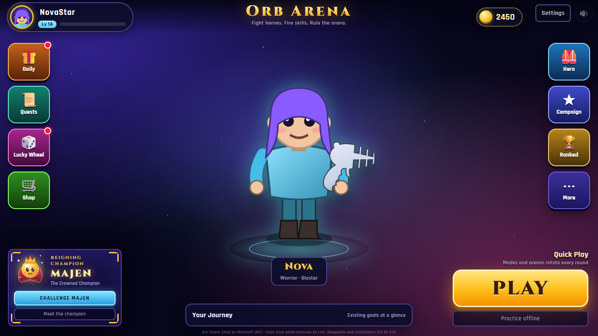
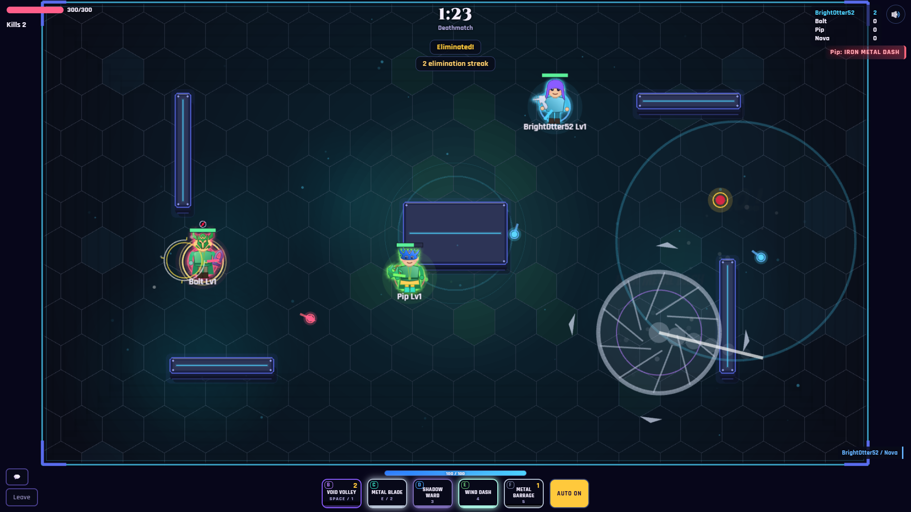
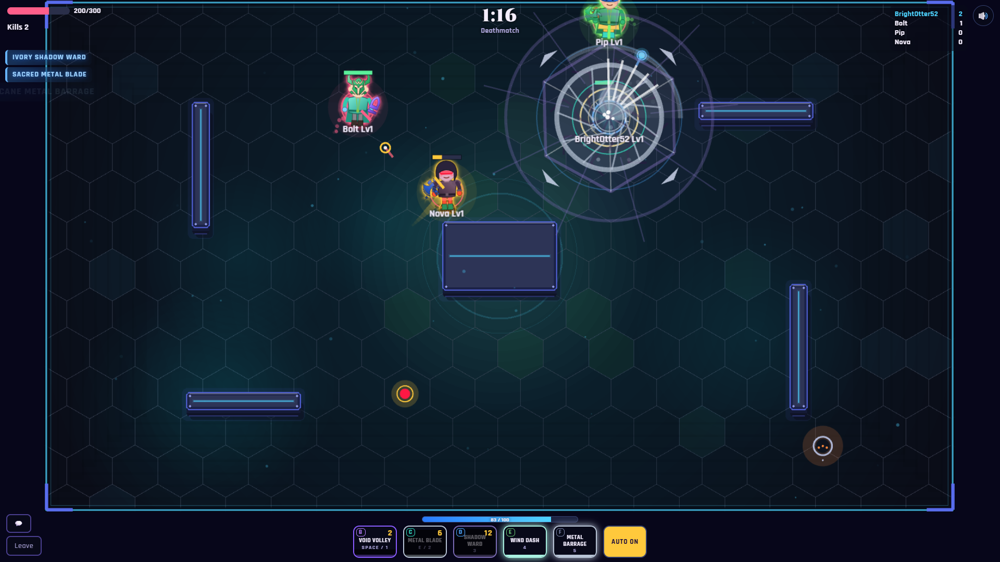
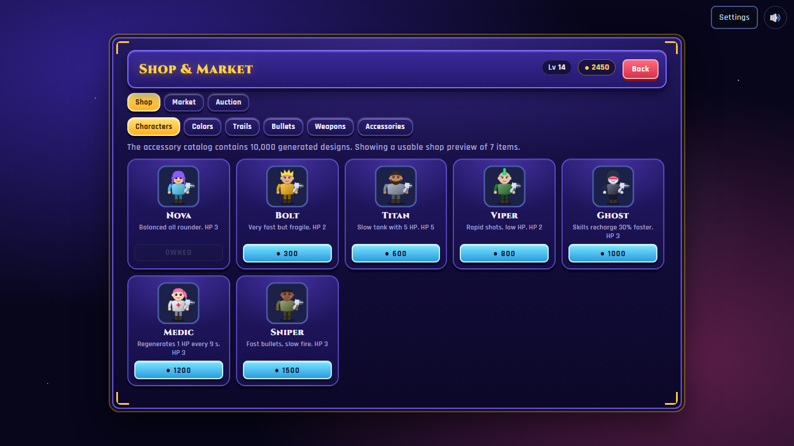
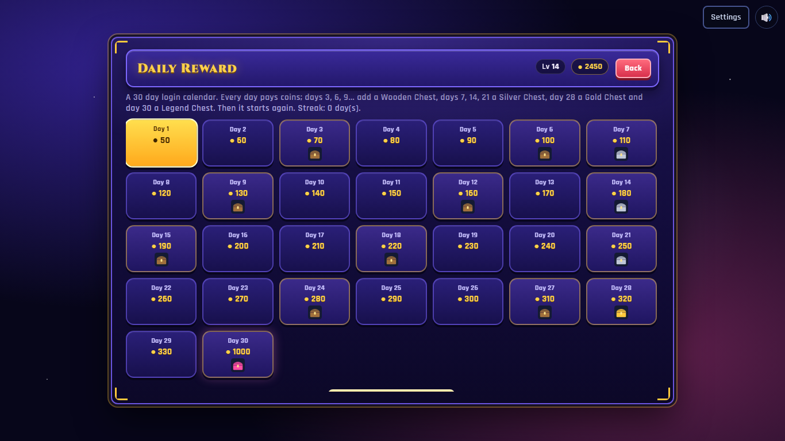
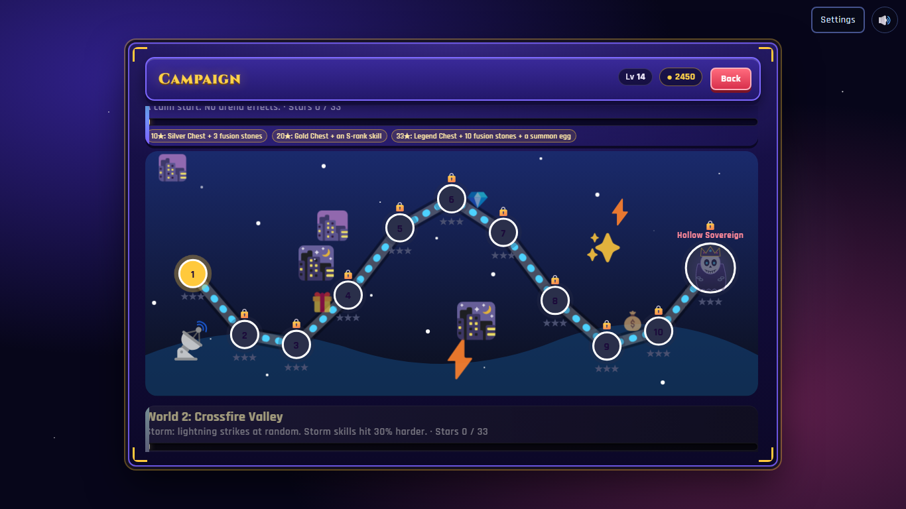
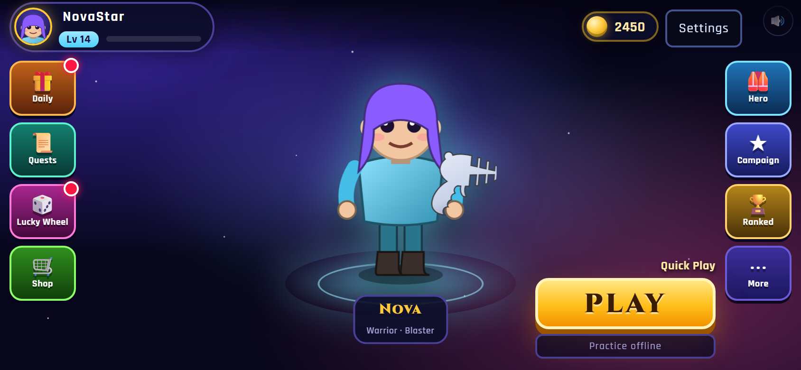

# Orb Arena

A real-time multiplayer arena shooter for the browser. Pick a hero, equip five skills and fight up to 8 players in
fast rounds. Bots fill the empty seats, so a match starts straight away. The game runs on desktop and mobile
(landscape and portrait) and is built for CrazyGames, Poki and itch.io.

**Play:** <https://majenayu.github.io/orb-arena-play/>



| Gameplay                                   | Skills in action                                     |
| ------------------------------------------ | ---------------------------------------------------- |
|  |  |
| **Shop**                                   | **Daily reward**                                     |
|          |           |
| **Campaign map**                           | **Phone (landscape)**                                |
|  |                  |

## Features

**Matches**

- Online rooms of up to 8 players, with bots that use pathfinding to fill free seats.
- 4 modes: Deathmatch, Team Battle (blue vs red), Coin Rush and King of the Hill.
- 25 arenas with 7 floor styles. Quick Play changes the mode and arena every round.
- Ranked 1v1 and 2v2 deathmatches with 6 tiers (Bronze to Starforged) and a world ranking.
- Shadow Duel, an unranked side-view fighting mode, online or against a bot.
- A short lobby bar before each match that confirms by itself after a few seconds.
- A step-by-step coach for the first match.

**Heroes and skills**

- 7 characters, 6 classes and 6 weapons, each with its own stats and passives.
- Battle skills built from 54 archetypes, 12 elements and 80 modifiers, with ranks from D up to unique skills.
- Your skill names show on the left in blue and your opponents' on the right in red.
- 1,008 powerups (12 effects x 4 rarities x 21 modifiers) and a collection page for the ones you find.
- 10,000 generated accessories in 8 slots, plus colours, trails and bullet styles.
- Gear in 8 slots, a fusion lab, 8 summon families and 12 emotes.

**Progression**

- Coins, XP and player levels.
- A campaign with 8 worlds and 88 levels, stars, and a boss at the end of each world.
- 9 boss fights, a Bestiary and the reigning champion Majen.
- A 30-day login calendar, daily and weekly quests, and treasure chests.
- One Lucky Wheel with a tab per category: coins and skins, skills, weapons, looks (8 genre wheels), gear and summons.
- Shop, Market and Auction House, Guilds, and a Training Ground.

## Tech stack

| Part      | Technology                                                        |
| --------- | ----------------------------------------------------------------- |
| Client    | Phaser 3, TypeScript, Vite, DOM and CSS for menus                 |
| Server    | Colyseus (Node 20+), authoritative at 20 ticks per second         |
| Shared    | Pure TypeScript game simulation (`Sim`) used by server and client |
| Storage   | Postgres through `DATABASE_URL`, file storage otherwise           |
| Tests     | Vitest (unit, 178 tests) and Playwright (end-to-end, 32 tests)    |
| Platforms | CrazyGames SDK v3, Poki SDK, plain web build for itch.io          |

## Getting started

You need Node.js 20 or newer.

```bash
npm install
npx playwright install chromium   # once, only for the end-to-end tests
npm run dev                       # server on :2567, client on http://localhost:5173
```

To test multiplayer locally, open <http://localhost:5173> in two browser tabs and press Play in both. They join the
same room.

### Controls

| Action | Desktop                             | Mobile        |
| ------ | ----------------------------------- | ------------- |
| Move   | WASD (ZQSD on AZERTY) or arrow keys | Left thumb    |
| Aim    | Mouse                               | Right thumb   |
| Shoot  | Left click                          | Right thumb   |
| Skills | Space or 1, E or 2, 3, 4, 5         | Skill buttons |
| Auto   | Auto button                         | Auto button   |

## Scripts

| Command                                                  | What it does                                                                           |
| -------------------------------------------------------- | -------------------------------------------------------------------------------------- |
| `npm run dev`                                            | Starts the server and the client together                                              |
| `npm run build`                                          | Builds the client into `client/dist`                                                   |
| `npm test`                                               | Unit tests (simulation, content, economy, prediction, server room)                     |
| `npm run e2e`                                            | Playwright tests: multiplayer, every page, every mode, campaign                        |
| `npm run typecheck`, `npm run lint`                      | Static checks                                                                          |
| `npm run crazygames`, `npm run poki`, `npm run itch`     | Builds an upload folder for that platform (see below)                                  |
| `npm run covers`, `npm run videos`, `npm run poki:media` | Renders cover images, preview videos and Poki screenshots (dev server must be running) |

## Project structure

```
shared/   game constants, content tables (heroes, skills, maps, levels, bosses, gear) and the Sim
server/   Colyseus ArenaRoom, matchmaking, accounts, leaderboard, /health and /ping
client/   Phaser renderer, home lobby and menu pages, save and economy, campaign, platform SDK wrappers
e2e/      Playwright tests and the scripts that render covers, videos and screenshots
scripts/  upload folder builder and zip builder
docs/     design notes, art direction, skill catalogue and screenshots
```

How the multiplayer works:

- `Sim` in `shared/` is the only game implementation. The server runs it for online play. The client runs it for
  offline practice and the campaign.
- The server decides positions, hits, skills, powerups, scores and rounds. Players only send input and a validated
  loadout.
- The client predicts its own movement and shows other players 100 ms behind, interpolated.
- Rooms are grouped by mode and map. Quick Play puts everyone in one rotating lobby.

## Configuration

| Variable           | Where  | Purpose                                                          |
| ------------------ | ------ | ---------------------------------------------------------------- |
| `VITE_SERVER_URLS` | client | Comma-separated `wss://` address of the game server for builds   |
| `VITE_PLATFORM`    | client | `poki` for the Poki build; leave empty otherwise                 |
| `VITE_ENABLE_ADS`  | client | Turns rewarded ads on (only where the platform allows ads)       |
| `DATABASE_URL`     | server | Postgres connection string for accounts and rankings (optional)  |
| `DATA_FILE`        | server | File used for saves when there is no database                    |
| `MAX_CONN_PER_IP`  | server | Limit on connections from one IP address                         |
| `KEEPALIVE_URL`    | server | Address the server pings so a free host does not put it to sleep |
| `PORT`             | server | Port to listen on (default 2567)                                 |

See `client/.env.example`. Never commit a real `.env` file.

## Deployment

- **Server:** `render.yaml` sets up the game server and a Postgres database on Render. `fly.toml` and
  `railway.json` are there for Fly.io and Railway. Full steps are in [DEPLOY.md](DEPLOY.md).
- **Upload folders:** run one of the commands below. The script refuses localhost or non-`wss://` addresses.

  ```powershell
  $env:VITE_SERVER_URLS="wss://your-server.example.com"
  npm run crazygames   # craygames/files, photos, videos (loose files, no zip)
  npm run poki         # poki/files, plus exactly 3 screenshots
  npm run itch         # itch/files/orb-arena.zip and a 630x500 cover
  ```

  The generated folders are git-ignored. Each folder has a README that explains what to upload where.

## Platform integration

- **CrazyGames:** `client/src/platform/crazygames.ts` loads SDK v3 only on CrazyGames or with `?crazygames=1`.
  It handles loading and gameplay events, mute, username, room data, invite links, instant multiplayer and cloud
  saves. Ads are off on CrazyGames.
- **Poki:** `client/src/platform/poki.ts` is loaded only in the Poki build. A commercial break runs before every
  match except the first, with input disabled and audio muted while the ad plays.

## Known limits

- Coins, levels and unlocks are saved on the player's device (or through the platform's save module). The server
  accepts any valid loadout, so unlocks are progression, not anti-cheat.
- The free Render Postgres database expires after 30 days. Use a paid plan or another host such as Neon for
  long-term rankings.

## More documents

- [DEPLOY.md](DEPLOY.md): hosting the server and database
- [ROADMAP.md](ROADMAP.md): planned work
- [STORE_TEXT.md](STORE_TEXT.md): store listing text
- [docs/](docs/): master plan, art direction, assets and skills

## Credits

- Art: [Fluent Emoji](https://github.com/microsoft/fluentui-emoji) by Microsoft (MIT).
- Icons: [game-icons.net](https://game-icons.net) by Lorc, Delapouite and contributors (CC BY 3.0).
- Fonts: Cinzel, Rajdhani and Bangers (SIL Open Font License).
