# Power contact sheets

Six frames per power from the Power Lab (`?powers=1`): anticipation, cast, travel, impact, impact +6 frames, aftermath. Frame-exact and reproducible (the sim and the effects are both seeded).

## Hot Shot — Fire Vanguard 1 (shot)

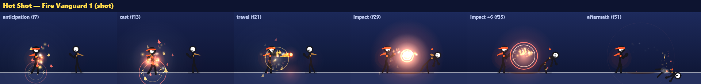

## Scorch Dash — Fire Vanguard 2 (dash)

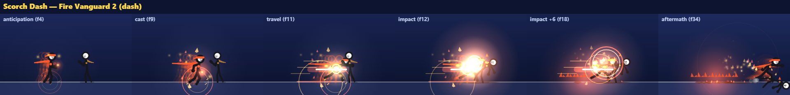

## Furnace Rise — Fire Vanguard 3 (pillar)

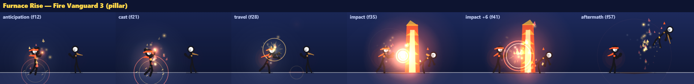

## Cinder Flurry — Fire Striker 1 (flurry)

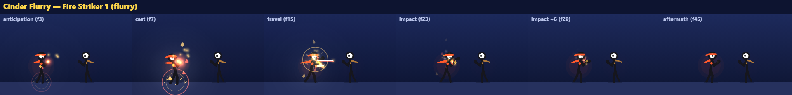

## Rising Flare — Fire Striker 2 (rising)

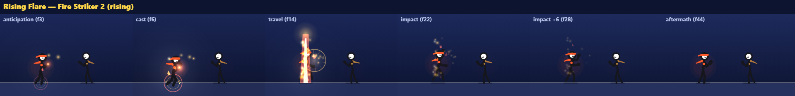

## Meteor Fall — Fire Striker 3 (rain)

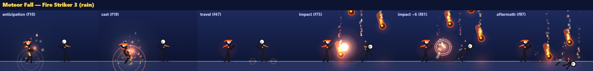

## Heat Ward — Fire Warden 1 (orbit)

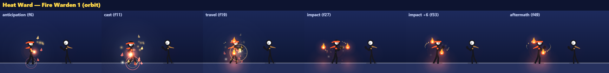

## Backdraft — Fire Warden 2 (counter)

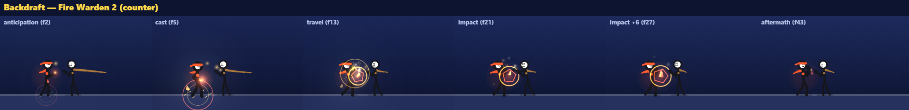

## Kiln Dome — Fire Warden 3 (aura)

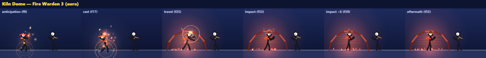

## Jet Lance — Water Vanguard 1 (shot)

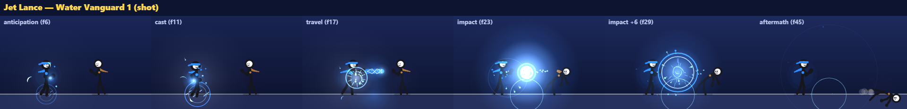

## Undertow — Water Vanguard 2 (wave)

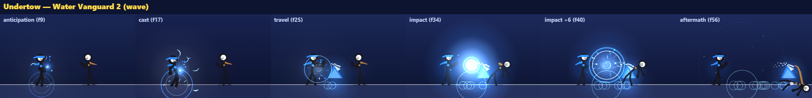

## Bubble Lock — Water Vanguard 3 (shot)

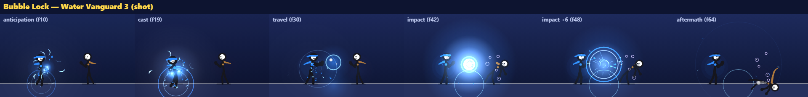

## Surf Strike — Water Striker 1 (dash)

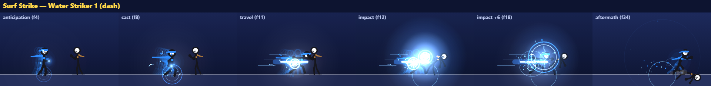

## Whirlpool Spin — Water Striker 2 (spin)

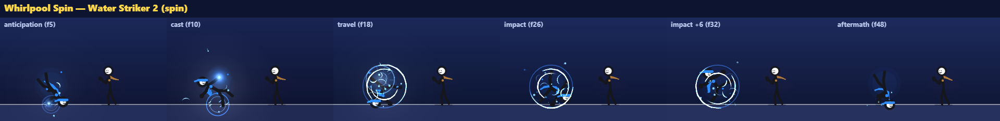

## Geyser Barrage — Water Striker 3 (multistrike)

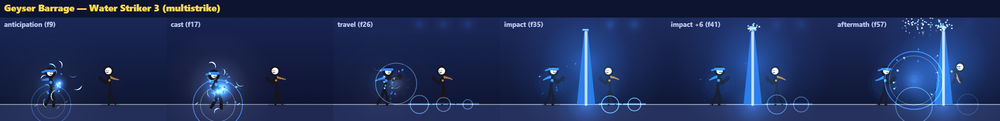

## Mist Double — Water Warden 1 (decoy)

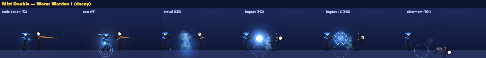

## Leech Stream — Water Warden 2 (drain)

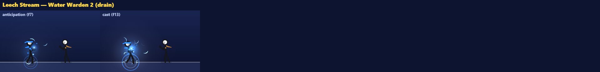

## Monsoon — Water Warden 3 (field)

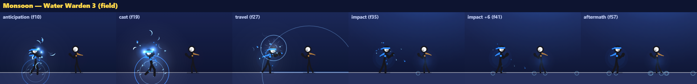

## Rime Dart — Ice Vanguard 1 (shot)

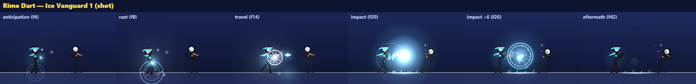

## Glacier Gate — Ice Vanguard 2 (wall)

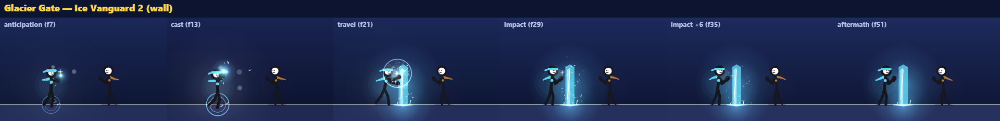

## Permafrost — Ice Vanguard 3 (aura)

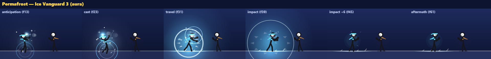

## Frost Fang — Ice Striker 1 (melee)

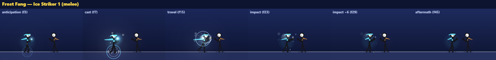

## Shard Fan — Ice Striker 2 (fan)

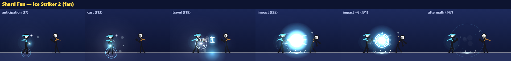

## Crystal Lance — Ice Striker 3 (beam)

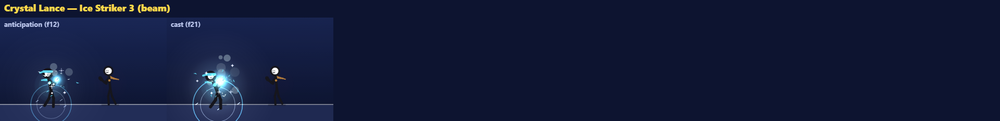

## Frost Mirror — Ice Warden 1 (counter)

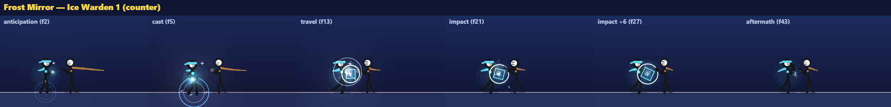

## Snow Double — Ice Warden 2 (decoy)

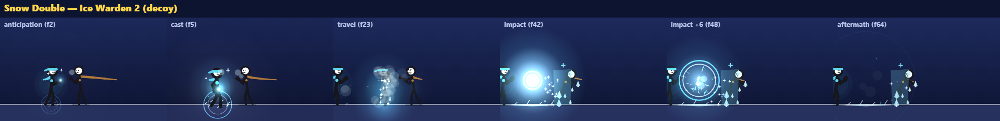

## Deep Winter — Ice Warden 3 (field)

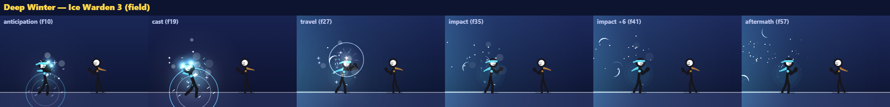

## Volt Hop — Lightning Vanguard 1 (teleportBehind)

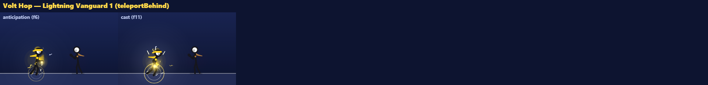

## Arc Lash — Lightning Vanguard 2 (beam)

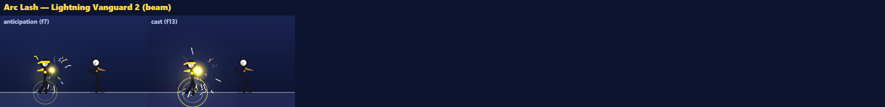

## Storm Mark — Lightning Vanguard 3 (drop)

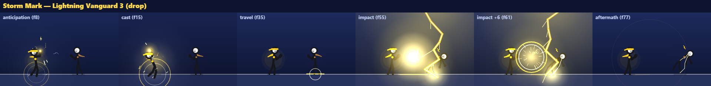

## Volt Flurry — Lightning Striker 1 (flurry)

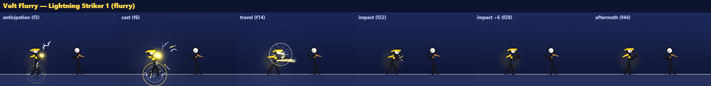

## Rail Dash — Lightning Striker 2 (dash)

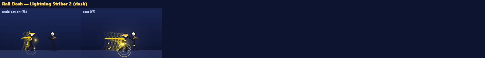

## Overcharge — Lightning Striker 3 (buff)

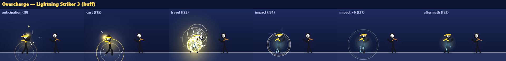

## Coil Guard — Lightning Warden 1 (orbit)

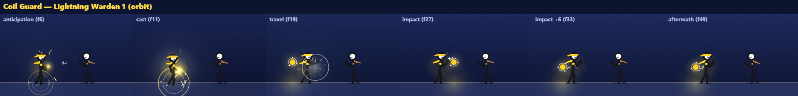

## Shock Mine — Lightning Warden 2 (trap)

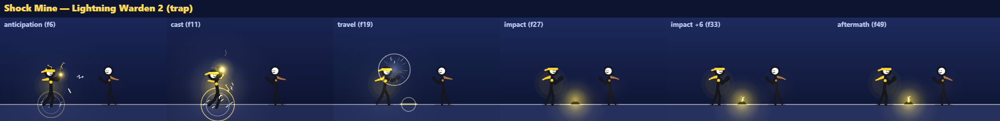

## Chain Storm — Lightning Warden 3 (multistrike)

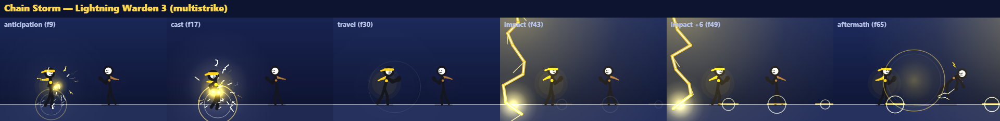

## Breeze Shove — Wind Vanguard 1 (melee)

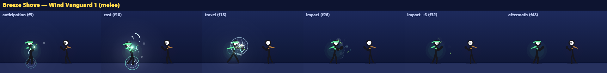

## Whirl Kick — Wind Vanguard 2 (spin)

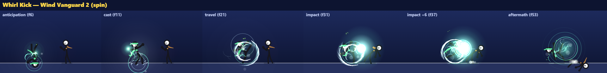

## Razor Draft — Wind Vanguard 3 (shot)

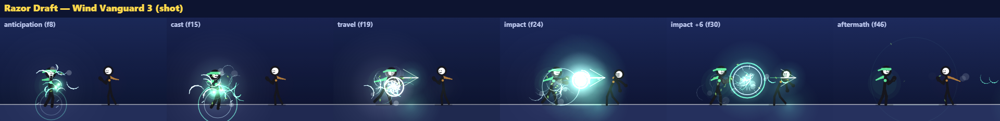

## Gale Step — Wind Striker 1 (dash)

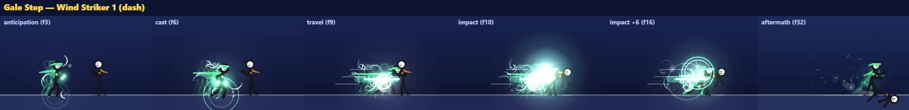

## Updraft — Wind Striker 2 (rising)

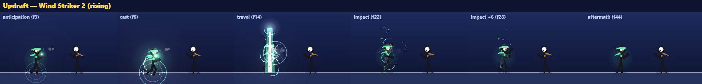

## Tempest Fan — Wind Striker 3 (fan)

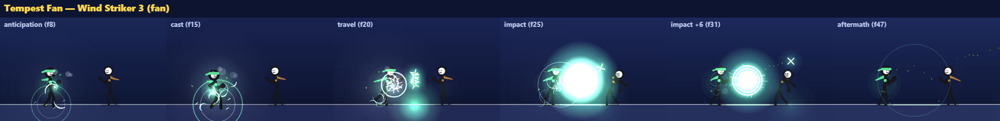

## Gust Wall — Wind Warden 1 (wall)

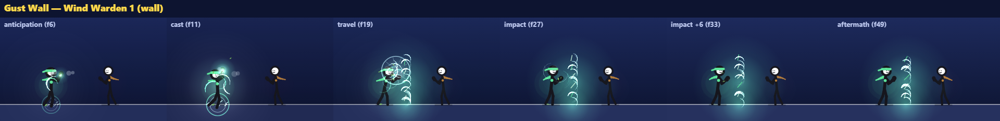

## Breeze Parry — Wind Warden 2 (counter)

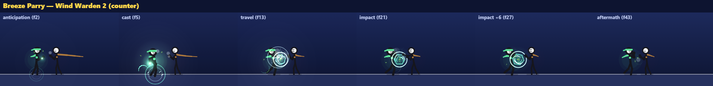

## Storm Eye — Wind Warden 3 (aura)

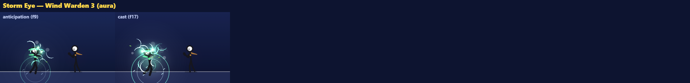

## Boulder Lob — Earth Vanguard 1 (lob)

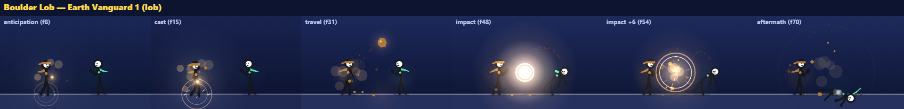

## Granite Fist — Earth Vanguard 2 (armor)

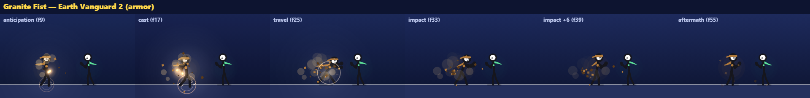

## Groundbreak — Earth Vanguard 3 (wave)

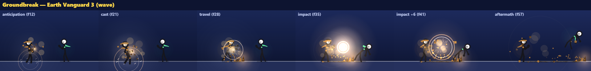

## Quarry Charge — Earth Striker 1 (dash)

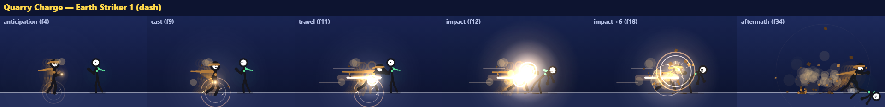

## Tremor Stomp — Earth Striker 2 (aura)

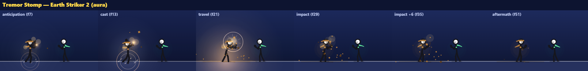

## Mountain Drop — Earth Striker 3 (drop)

## Stone Skin — Earth Warden 1 (buff)

## Spike Pit — Earth Warden 2 (trap)

## Stone Prison — Earth Warden 3 (multistrike)

## Vine Snare — Leaf Vanguard 1 (reach)

## Burr Mine — Leaf Vanguard 2 (trap)

## Thicket Rise — Leaf Vanguard 3 (heal)

## Thorn Lash — Leaf Striker 1 (flurry)

## Seed Spray — Leaf Striker 2 (fan)

## Petal Storm — Leaf Striker 3 (rain)

## Leaf Ring — Leaf Warden 1 (orbit)

## Snap Trap — Leaf Warden 2 (counter)

## Sap Siphon — Leaf Warden 3 (drain)

## Bright Dart — Light Vanguard 1 (shot)

## Sunlance — Light Vanguard 2 (beam)

## Shine Shield — Light Vanguard 3 (barrier)

## Flash Step — Light Striker 1 (teleportBehind)

## Prism Fan — Light Striker 2 (fan)

## Daybreak — Light Striker 3 (buff)

## Halo Ring — Light Warden 1 (orbit)

## Mirror Image — Light Warden 2 (decoy)

## Starfall — Light Warden 3 (rain)

## Grav Well — Gravity Vanguard 1 (field)

## Anchor Drop — Gravity Vanguard 2 (drop)

## Weightless — Gravity Vanguard 3 (shot)

## Crush Step — Gravity Striker 1 (dash)

## Return Comet — Gravity Striker 2 (boomerang)

## Meteor Shower — Gravity Striker 3 (rain)

## Satellite — Gravity Warden 1 (orbit)

## Repulse — Gravity Warden 2 (counter)

## Gravity Cage — Gravity Warden 3 (field)

## Rewind Step — Time Vanguard 1 (recall)

## Tick Field — Time Vanguard 2 (field)

## Freeze Frame — Time Vanguard 3 (shot)

## Second Flurry — Time Striker 1 (flurry)

## Blink Cut — Time Striker 2 (dash)

## Haste Hour — Time Striker 3 (buff)

## Hour Hand — Time Warden 1 (orbit)

## Afterimage — Time Warden 2 (decoy)

## Time Lock — Time Warden 3 (counter)

