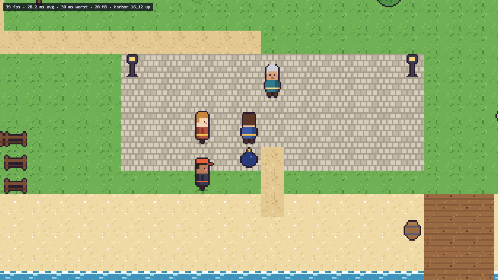

# Talewild

A single-player creature-adventure RPG for the browser. You are a young Scribe in Inkmere, a world that is a living
storybook. Bind legends in creature form (Echoes), build a team for 3v3 Chorus battles, win the Keepers' Pages and
decide how the story ends.

**Status: Phase 1 (engine foundation) done.** Play the test build: https://majenayu.github.io/orb-arena-play/talewild/



## Run it

```bash
npm install
npm run dev          # http://localhost:5180 (debug mode on)
npm test             # unit tests (rules, saves, maps, scripts)
npm run build        # production build in dist/ plus the size report
npm run e2e          # Playwright smoke test against the production build
npm run shots        # screenshots at 1366x768, 1920x1080, 390x844, 844x390
npm run build:crazygames   # build that always uses the CrazyGames SDK
```

Controls: arrow keys or WASD to move, Shift to run, Space/Enter/E to talk, Esc to pause, X or Backspace to go back.
Gamepad and touch controls work too. Add `?debug=1` to the URL for the debug panel (F9).

## Layout

| Folder | What is in it |
| ------ | ------------- |
| `src/core` | Loop, input, saves, storage, i18n, RNG, lazy chapter loader |
| `src/world` | Tiled map format, ASCII map generator, grid movement, NPC behaviour, map validator |
| `src/script` | Event-script format, runner, flags and bag |
| `src/render` | Tileset and character art drawn in code, Phaser tilemap glue |
| `src/scenes` | Boot, title and world scenes |
| `src/ui` | Dialogue, menus, touch controls, debug panel, styles |
| `src/platform` | Web and CrazyGames SDK v3 behind one interface |
| `src/content` | Chapters (maps, scripts), character looks, English text |
| `tests` | Unit tests (Vitest) |
| `e2e` | End-to-end tests and screenshots (Playwright) |
| `tools` | Size report, SVG renderer |

## Documents

| Document | What it holds |
| -------- | ------------- |
| [docs/GDD.md](docs/GDD.md) | Game design |
| [docs/STORY.md](docs/STORY.md) | Story outline, cast, endings, side content |
| [docs/ECHOES.md](docs/ECHOES.md) | The 70 Echo families |
| [docs/MOTIFS.md](docs/MOTIFS.md) | The Motif (type) wheel |
| [docs/DECISIONS.md](docs/DECISIONS.md) | Owner decisions and name checks |
| [docs/ASSETS.md](docs/ASSETS.md) | Third-party assets and libraries |
| [docs/phases/](docs/phases/) | One report per phase |
