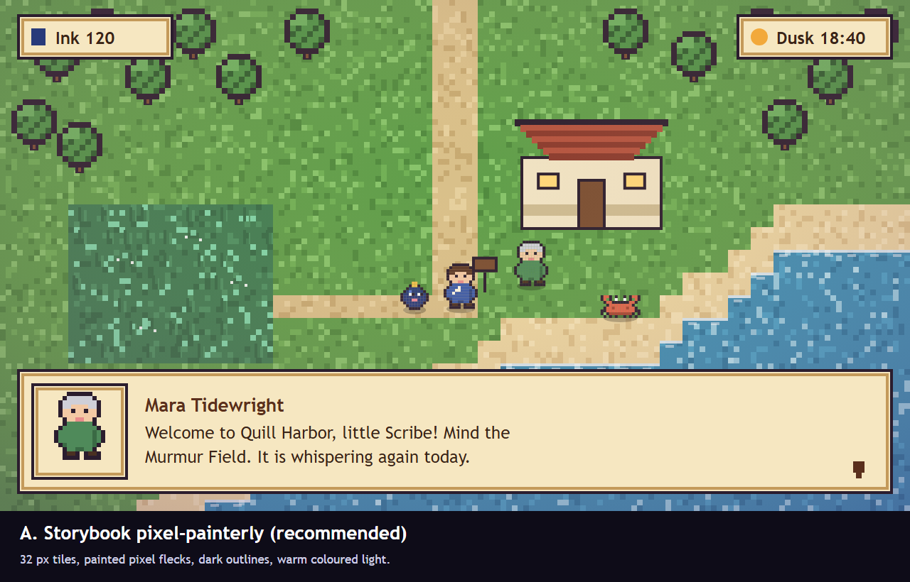
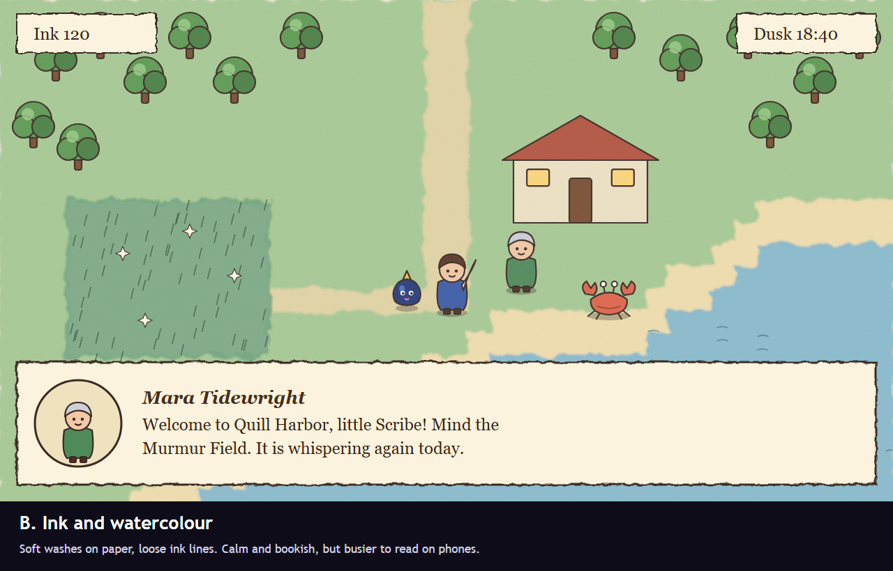
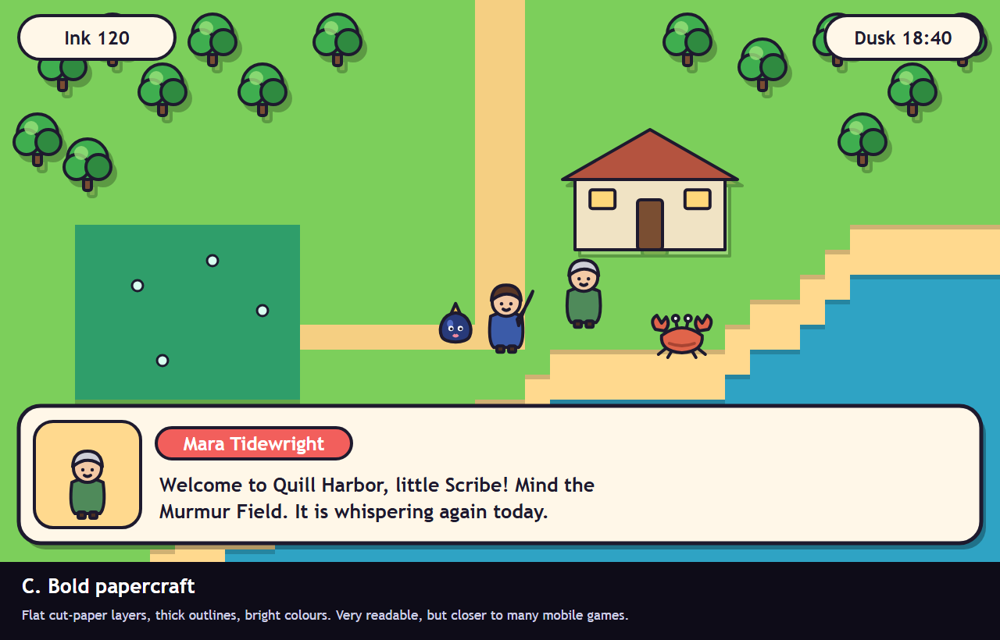
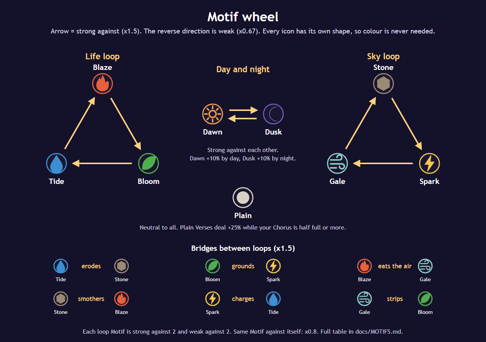
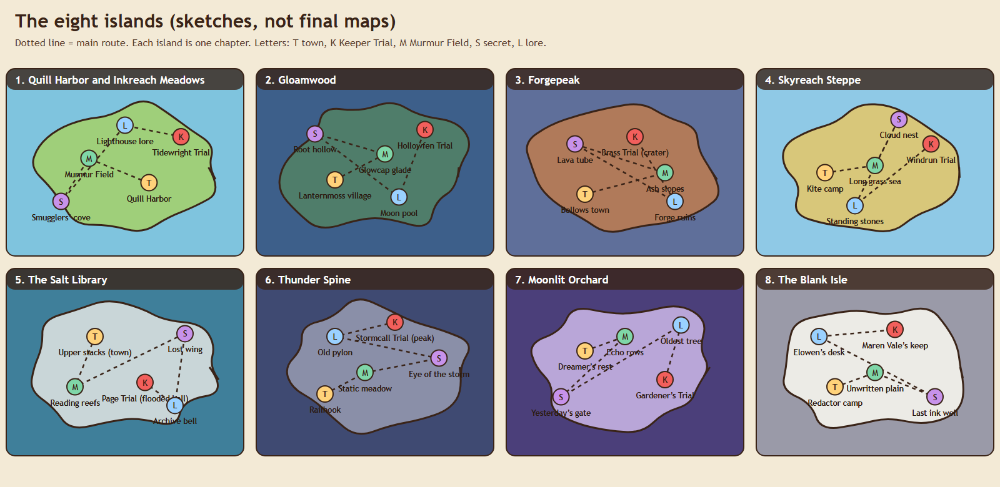
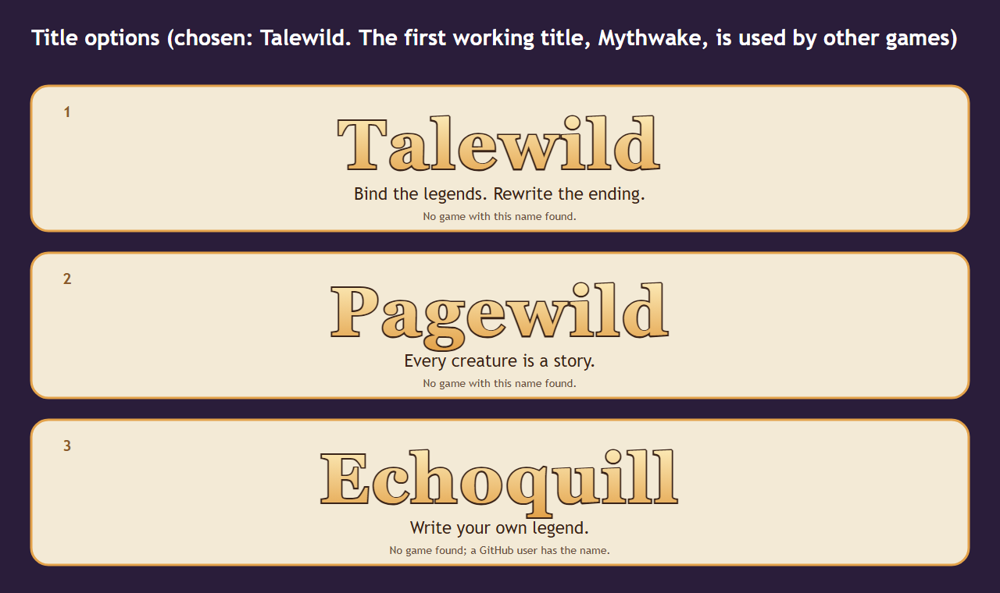

# Phase 0: Concept lock

## What changed

- `docs/GDD.md`: design: vocabulary, loops, the first 5 minutes, Chorus battle system with formulas and statuses,
  Binding Rites, Bond, Tales, Legend Paths, islands, art and audio direction, ads, retention, accessibility, tech plan,
  content targets, scope honesty and unverified items.
- `docs/STORY.md`: premise, the hidden truth and its foreshadowing, main cast with arcs and scenes, 8 Keeper subplots,
  3 redeemable Redactor commanders, companions, chapter beats (Episode 1 ends after Chapter 2), 3 endings with
  requirements, Tale format with an example, 15 Episode 1 side quests, the full side content plan.
- `docs/ECHOES.md`: 70 Echo families (22 for Episode 1 giving 60 Echoes, 36 for chapters 3 to 8, 12 legendary), each
  with Motif, temperament, habitat, form count, silhouette rule, signature feature and legend.
- `docs/MOTIFS.md` and `mockups/motif-chart.png`: the original Motif wheel (two loops, six bridges, Dawn and Dusk,
  Plain), balanced so every loop Motif is strong against 2 and weak against 2.
- `mockups/islands.png`: sketch maps of the 8 islands.
- `mockups/style-A/B/C.png`: the same Quill Harbor scene in 3 art styles.
- `mockups/names.png`: 3 title options.
- `docs/DECISIONS.md`: 9 owner decisions.

## Screenshots

| Style A (recommended) | Style B | Style C |
| --------------------- | ------- | ------- |
|  |  |  |

## Tests

No game code in this phase. The mockup script runs without errors; all six PNGs were checked by eye. The Motif table
was checked by hand: every loop Motif has two x1.5 and two x0.67 entries both as attacker and as defender.

## Findings

- "Mythwake" is used by an online 2D RPG (playmythwake.com) and others; "Veyra" by a browser RPG on itch.io.
- "Pip" (Orb Arena), "Bram" and "the Quiet" (Sunfetch) break the no-reuse rule and were replaced.
- The first Motif bridge design was unbalanced (Ember, Stone and Spark had more weaknesses); it now has six bridges.
- The first Ember icon was a drop, too close to Tide; it is now a three-tongued flame.
- 25 to 35 hours is not a realistic full-game length; 15 to 20 hours is proposed (D6).

## Risks

- Content volume (180 Echoes, 70 Tales) depends on the procedural creature builder looking good.
- Battle depth must be proven by the simulator in Phase 2 before Episode 1 content is built.
- Phone performance is unverified.

## Next step

1. Owner answers D1 to D9 in `docs/DECISIONS.md`.
2. Phase 1: engine foundation (loop, input, tile maps, camera, collision, NPCs, dialogue, scripting, saves, loader,
   platform layer, debug tools) with a small walkable test map.

## Update after the owner's decisions

All decisions are answered (see DECISIONS.md). The project folder is now `Talewild/`; names in all documents and mockups were updated (Talewild, Inkmere, Blaze, Keepsakes, Forgepeak). The findings above still use the names that were current at the time.
