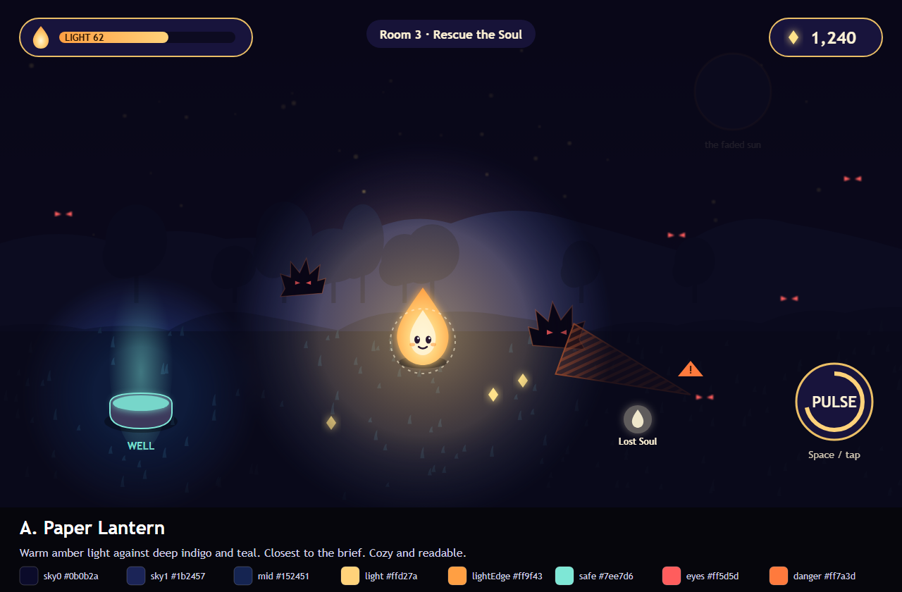
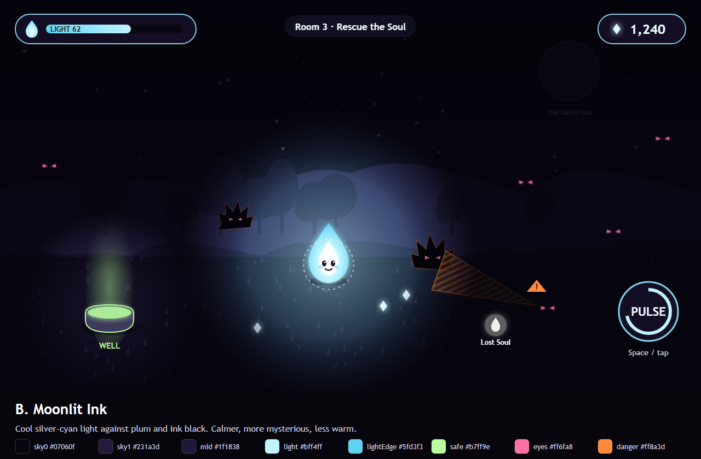
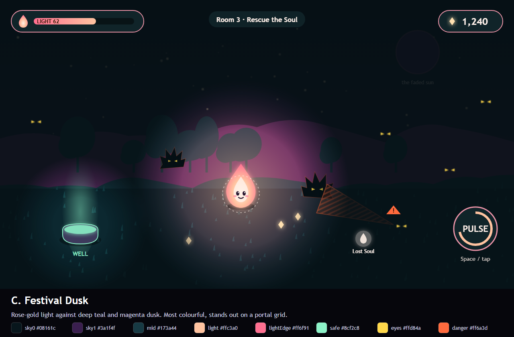
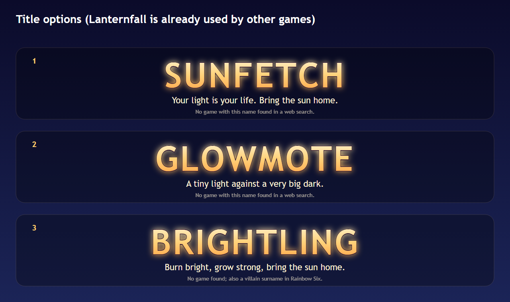

# Phase 0: Concept lock

## What changed

- `docs/GDD.md`: full design: Light rules with first numbers, run structure, 6 Spirits, 5 worlds, 5 bosses and 5
  mini-bosses, 30 enemy types, 60 Flames, 12 Resonances, 20 Charms, 25 Relics, 15 events, Lighthouse meta, retention,
  ads, difficulty, accessibility, tech plan, risks and unverified items.
- `docs/STORY.md`: prologue, 5 world intros and outros, boss lines, the finale choice, 12 Lost Souls with ending
  payoffs, 3 endings, credits and Spirit bios.
- `docs/DECISIONS.md`: 8 owner decisions (title, palette, renames, run length, run end, stack, git home, small items).
- `docs/mockups/`: 3 palette mockups of the same scene and a title sheet, as SVG and PNG, made by
  `make-mockups.mjs`.
- `docs/ASSETS.md`: empty asset register.

## Screenshots

| Palette A | Palette B | Palette C |
| --------- | --------- | --------- |
|  |  |  |

## Tests

No game code in this phase, so there are no tests. The mockup script ran without errors and all four PNGs were
checked by eye.

## Findings

- "Lanternfall" is used by at least five existing games (web search).
- The itch.io game Hushlight uses a hero named Wick, a darkness called the Hush, and an Ember that is health and
  weapon, which matches the brief closely.
- The brief's "Nova" is already a character in Orb Arena.
- The brief's run length (6 to 10 minutes) conflicts with five worlds of six stages in one run.
- CrazyGames currently requires an initial download of 50 MB or less, and 20 MB or less for the mobile homepage
  ([technical requirements](https://docs.crazygames.com/requirements/technical/)). Our own target stays under 8 MB.

## Risks

- Content volume is large; the plan is data tables and building World 1 fully before the rest.
- Darkness rendering on low-end phones is unproven until Phase 1 runs on a device.

## Next step

Owner answers D1 to D8 in `docs/DECISIONS.md`. Then Phase 1: the vertical slice (project setup, Wick, Hollow Meadow
rooms 1 to 3, the Light mechanic, 6 enemies, 10 Flames, Thornback, basic UI, music and SFX).
